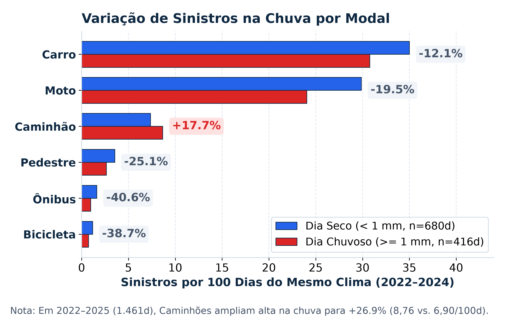
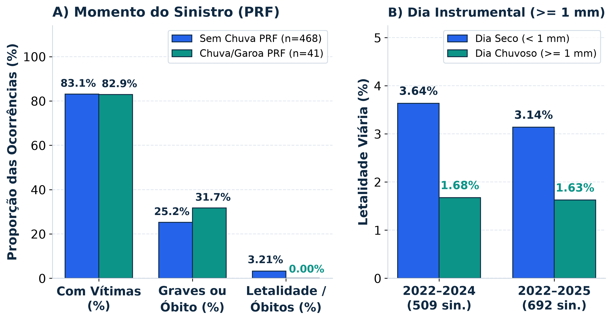
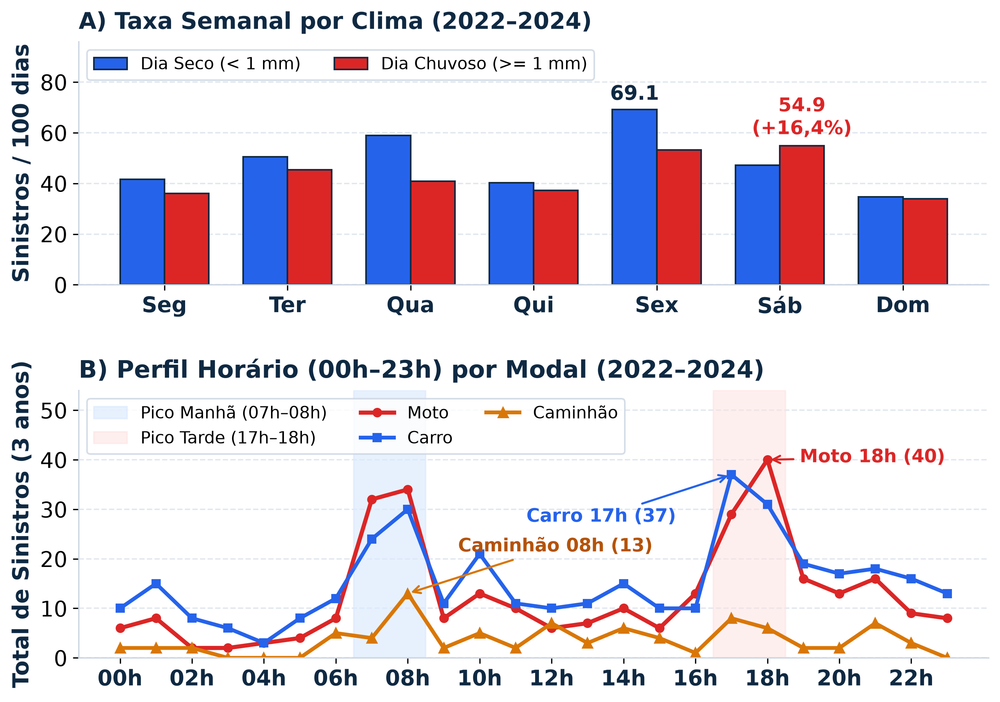

<!-- _class: cover -->
<!-- _paginate: false -->

Observatório de Londrina · Eixo Mobilidade

# Chuva Reduz a Letalidade, mas Eleva o Risco para Caminhões na BR-369

Relação entre condições meteorológicas diárias (INMET), volume, gravidade e dinâmica modal/horária dos sinistros rodoviários federais em Londrina-PR (2022–2025)

  
<strong>Autores</strong>Caio Gabriel Duque Cotting &amp; Victor Gomes Cardoso

  
<strong>Disciplina / Docente</strong>Ciência de Dados / Machine Learning · Prof. Mário Adaniya

  
<strong>Fontes Oficiais</strong>PRF (Datatran / Pessoas) + INMET (83766, SBLO, A835, ERA5)

---

Escopo, Engenharia de Dados &amp; Qualidade · 2022–2025

# Estação local de Londrina (83766) elevou a concordância com a PRF de 82,9% para 95,1%

  

    
1.096 d

    
Recorte Oficial (2022–24)

    
1.461 dias até 2025 (676 sem sinistros = 61,7%)

  

  

    
509

    
Sinistros PRF Londrina

    
99,4% na BR-369 (692 até 2025; 15 → 18 óbitos)

  

  

    
1.265

    
Envolvidos / Veículos

    
1.721 registros até 2025 (sem perda no join)

  

  

    
95,1%

    
Concordância ≥ 1 mm

    
100,0% &gt; 0 mm na série local (vs. 82,9% na A835)

  

  

    <h2>Descoberta Crítica na Exploração (Slide 9)</h2>
    <ul>
      <li>Nos pacotes <code>.zip</code> do INMET, o código <code>A835</code> pertence a <strong>Maringá-PR</strong> (80 km a oeste) e falha após fev/2025.</li>
      <li>A estação oficial dentro de Londrina é a <strong>Convencional 83766</strong> (complementada por <code>SBLO 83768</code> e <code>ERA5</code>).</li>
    </ul>
  

  

    <h2>Qualidade e Preservação de Zeros (Slides 34–39)</h2>
    <ul>
      <li>Base atômica diária (<code>1 linha = 1 dia civil</code>) preserva todos os <strong>676 dias zero</strong> em 2022–2024.</li>
      <li>Dados brutos intocados; limpeza reprodutível em <code>UTC→GMT-3</code>, sentinelas <code>-9999</code> e <code>idade = 0</code> → <code>NaN</code>.</li>
    </ul>
  

---

Perguntas 1 e 2 + Resolução do Paradoxo da Chuva · 2022–2024

# Dias secos e frios concentram mais sinistros; na chuva, só caminhões sobem (+17,7%)

  

    
  

  

    <ul>
      <li><strong>Média diária bruta menor na chuva:</strong> <code>0,430</code> vs. <code>0,485 sinistros/dia</code> (<code>-11,3%</code>; Welch <code>p = 0,1675</code>).</li>
      <li><strong>Janela temporal real:</strong> apenas <strong>6,93% das horas</strong> (<code>1.786/25.767 h</code>) têm chuva; só <strong>21,8%</strong> dos sinistros de dias chuvosos ocorrem sob precipitação.</li>
      <li><strong>Retração de vulneráveis vs. cargas:</strong> motos (<code>-19,5%</code>), pedestres (<code>-25,1%</code>) e ônibus (<code>-40,6%</code>) recuam; <strong>caminhões sobem +17,7%</strong> (<code>+26,9%</code> até 2025).</li>
      <li><strong>Efeito térmico (P2):</strong> dias frios (<code>≤ 19°C</code>) registram a maior média (<strong><code>0,527/dia</code></strong> vs. <code>0,445</code> em dias quentes).</li>
    </ul>
  

---

Pergunta 3 &amp; Teste da Hipótese · Severidade e Letalidade

# Zero óbitos sob chuva na PRF confirmam a hipótese de menor letalidade em pista molhada

  

    
  

  

    <ul>
      <li><strong>Momento exato do sinistro (PRF 2022–24):</strong> nos <code>41</code> registros sob chuva/garoa houve <strong>0 óbitos (0,00%)</strong>, contra <strong>3,21%</strong> (<code>15</code> óbitos em <code>468</code> casos) sem chuva.</li>
      <li><strong>Gravidade sem óbito:</strong> sob chuva momentânea, lesões graves chegam a <code>31,7%</code> vs. <code>25,2%</code>, mas a energia fatal cai drasticamente.</li>
      <li><strong>Consistência em 4 anos (2022–25):</strong> no dia instrumental (<code>≥ 1 mm</code>), a letalidade cai pela metade tanto em 2022–24 (<code>1,68%</code> vs. <code>3,64%</code>) quanto em 2022–25 (<code>1,63%</code> vs. <code>3,14%</code>).</li>
    </ul>
    

      <strong>Veredito sobre a Hipótese:</strong> confirmada na letalidade — velocidades mais moderadas sob pista molhada convertem colisões potencialmente fatais em sinistros sem óbitos.
    

  

---

Dinâmica Espacial, Semanal, Horária &amp; Gênero · BR-369

# 89,1% dos sinistros ocorrem no km 145–159,3, com picos às 07h–08h, 17h–18h e sábados chuvosos

  

    
  

  

    <ul>
      <li><strong>Sexta seca vs. sábado chuvoso:</strong> sexta-feira seca lidera (<code>69,1/100d</code>), mas o <strong>sábado</strong> é o único dia que piora na chuva (<code>54,9</code> vs. <code>47,2/100d</code>; <code>+31,7%</code> até 2025).</li>
      <li><strong>Picos operacionais distintos:</strong> motos e carros explodem às <code>07h–08h</code> e <code>17h–18h</code>; <strong>caminhões concentram pico às <code>08h</code></strong> (<code>34,6%</code> do total são colisões traseiras).</li>
      <li><strong>Corredor crítico:</strong> <strong>89,1%</strong> (<code>451/506</code>) dos casos da BR-369 concentram-se entre o <strong>km 145 e o km 159,3</strong>.</li>
      <li><strong>Recorte de gênero (2022–24):</strong> homens somam <strong>84,5%</strong> dos condutores (<code>98,9%</code> em caminhões); mulheres somam <strong>60,1%</strong> dos passageiros e recuam mais na chuva (<code>-20,9%</code> vs. <code>-15,0%</code>).</li>
    </ul>
  

---

Machine Learning · Validação Cronológica Estrita &amp; Clusterização

# K-Means isola 119 dias críticos e Regressão Logística L2 generaliza melhor em 2025

  

    <h2>Classificação de Severidade (<code>tem_grave_ou_morte</code>)</h2>
    <table>
      <thead>
        <tr>
          <th>Modelo (Treino 22–23)</th>
          <th>Val ROC (2024)</th>
          <th>Test ROC (2025)</th>
          <th>Test PR / F1</th>
        </tr>
      </thead>
      <tbody>
        <tr>
          <td>Naive Baseline</td>
          <td>0,500</td>
          <td>0,500</td>
          <td>0,295 / 0,000</td>
        </tr>
        <tr class="highlight">
          <td>Logistic Regression (L2)</td>
          <td>0,563</td>
          <td>0,584</td>
          <td>0,357 / 0,448</td>
        </tr>
        <tr>
          <td>Random Forest (Reg.)</td>
          <td>0,528</td>
          <td>0,555</td>
          <td>0,339 / 0,404</td>
        </tr>
        <tr>
          <td>Gradient Boosting (Reg.)</td>
          <td>0,510</td>
          <td>0,551</td>
          <td>0,343 / 0,094</td>
        </tr>
      </tbody>
    </table>
    

      <strong>Transparência metodológica:</strong> modelos lineares regularizados evitam <em>overfitting</em> melhor que árvores em amostras municipais moderadas; na predição diária agregada só com clima/calendário, o sinal fica próximo ao acaso (<code>Val ROC ≈ 0,49</code>).
    

  

  

    <h2>3 Regimes Climático-Viários (K-Means <code>k = 3</code>)</h2>
    

      <h3>Cluster 0 — Chuvoso Persistente (205 dias)</h3>
      
Chuva média de <strong>15,56 mm/d</strong> (<code>14,4h</code> ERA5), baixa amplitude (<code>5,82°C</code>) e baixíssima severidade: <code>0,37 acid/d</code> e <strong><code>0,05 graves/d</code></strong>.

    

    

      <h3>Cluster 1 — Seco Rotineiro (772 dias)</h3>
      
Tempo seco (<code>0,94 mm/d</code>), alta amplitude (<code>11,20°C</code>), <code>0,34 acid/d</code> e <strong><code>0,00 graves ou fatais/d</code></strong>.

    

    

      <h3>Cluster 2 — Dias Críticos (119 dias)</h3>
      
Tempo aberto/chuva esparsa (<code>1,84 mm/d</code>) concentrando <strong><code>1,42 acid/d</code></strong> e <strong><code>1,02 graves/fatais/d</code></strong> (Silhouette <code>0,4040</code>; PCA <code>65,5%</code> = <code>40,6%</code> + <code>24,8%</code>).

    

  

---

<!-- _class: closing -->

Conclusões Práticas, Limitações &amp; Próximos Passos

# Fiscalização por corredor, modal e horário maximiza prevenção — respeitando os limites dos dados

  

    <h2>Ações Operacionais Recomendadas (BR-369)</h2>
    <ul>
      <li><strong>Corredor prioritário (km 145–159,3):</strong> concentra <strong>89,1%</strong> das ocorrências federais do município.</li>
      <li><strong>Dias secos, frios e sextas (07h–08h / 17h–18h):</strong> controle de velocidade e distância de seguimento para motos e carros (<code>34,6%</code> colisões traseiras).</li>
      <li><strong>Chuva e manhãs das 08h:</strong> fiscalização focada em <strong>caminhões e carretas</strong> (<code>+17,7%</code> a <code>+26,9%</code> na chuva) e reforço preventivo nos <strong>sábados chuvosos</strong> (<code>54,9/100d</code>).</li>
    </ul>
  

  

    <h2>Limitações Explícitas &amp; Continuidade (Slides 49–51)</h2>
    <ul>
      <li><strong>Sem denominador de exposição:</strong> ausência de VMD horário da BR-369 e de frota/CNH por gênero impede afirmar risco relativo por km rodado.</li>
      <li><strong>Correlação ≠ Causalidade:</strong> média menor na chuva reflete retração de duas rodas e apenas <code>6,93%</code> de horas chuvosas.</li>
      <li><strong>Granularidade e próximos passos:</strong> cruzar chuva horária local no timestamp do sinistro e integrar contagens de radares/pedágios (DNIT).</li>
    </ul>
  

