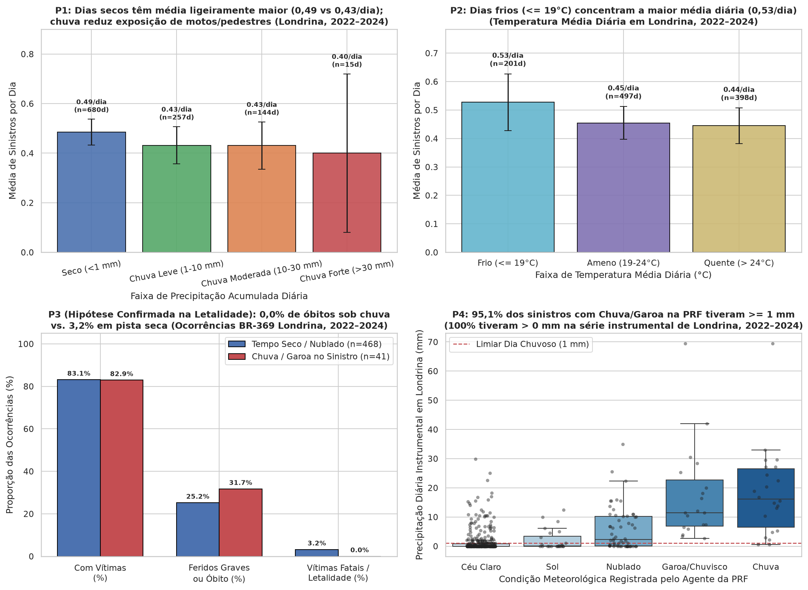
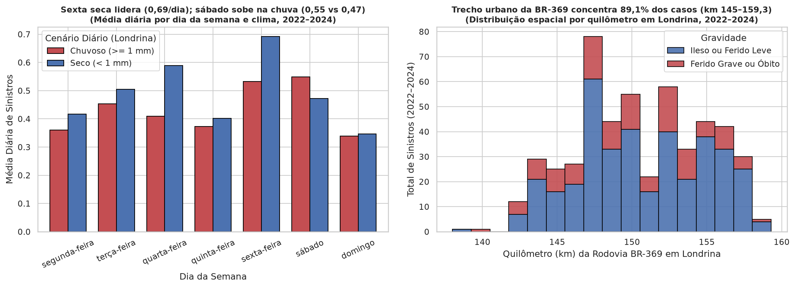
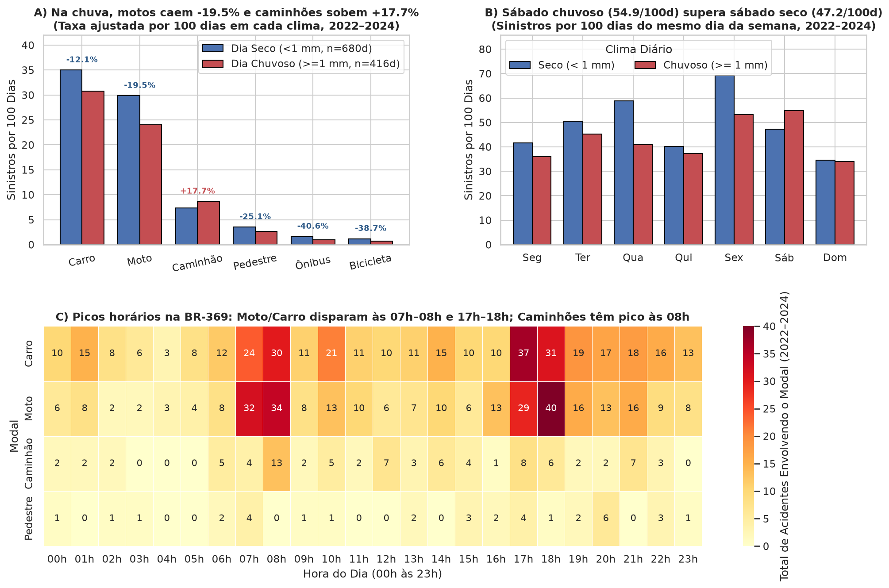
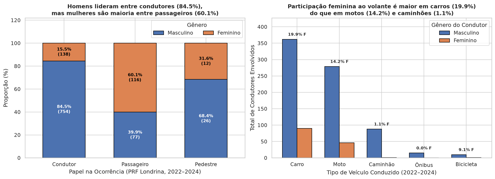
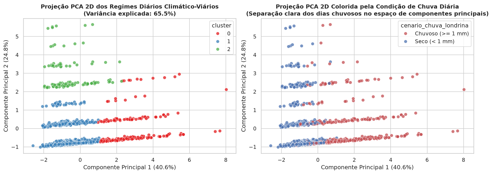

# Relatório Analítico Final — Clima e Sinistros Rodoviários em Londrina (BR-369, 2022–2025)

**Disciplina:** Ciência de Dados / Machine Learning  
**Docente:** Prof. Mário Henrique Akihiko da Costa Adaniya  
**Projeto:** Observatório de Londrina — Eixo Mobilidade  
**Autores (Dupla):**
* **Caio Gabriel Duque Cotting**
* **Victor Gomes Cardoso**

**Repositório Analítico (Código e Notebook Executado):**
* Aquisição e ETL: `src/download_dados_brutos.py` e `src/etl_pipeline.py`
* Análise Estatística e Machine Learning: `src/analise_exploratoria_e_ml.py`
* Notebook Interativo Executado: `notebooks/01_eda_integracao_e_ml_londrina.ipynb`

---

## Resumo Executivo

Este relatório consolida os achados da investigação quantitativa sobre a relação entre condições meteorológicas diárias (precipitação e temperatura) e a dinâmica dos sinistros atendidos pela Polícia Rodoviária Federal (PRF) nas rodovias federais de **Londrina-PR** (em especial a travessia urbana da **BR-369**, responsável por **$99{,}4\%$** das ocorrências em 2022–2024). No recorte oficial do **Project Canvas (2022–2024, $1.096\text{ dias}$)**, foram registrados **$509\text{ sinistros}$** ($541\text{ feridos}$ e $15\text{ óbitos}$, média de $0{,}464\text{ sinistros/dia}$), alcançando **$692\text{ sinistros}$** ($744\text{ feridos}$ e $18\text{ óbitos}$) quando estendido até **2025 ($1.461\text{ dias}$)** para validação temporal fora da amostra (*holdout*).

Os principais resultados descobertos ao longo do ciclo iterativo de análise são:

1. **Paradoxo da Chuva Explicado por Exposição e Janela Horária:** Na comparação bruta de dias civis completos (2022–2024), dias chuvosos ($\ge 1{,}0\text{ mm}$) apresentam média ligeiramente menor que dias secos ($0{,}430$ vs. $0{,}485\text{ acidentes/dia}$; Welch $p = 0{,}1675$). Isso ocorre porque **a chuva só está presente em $6{,}93\%$ das horas do triênio** ($1.786$ de $25.767\text{ horas}$ na série horária `A835`), apenas **$21{,}8\%$** dos sinistros de dias chuvosos acontecem debaixo de precipitação no momento da colisão e a chuva retrai fortemente a circulação de motocicletas (**$-19{,}5\%$**), pedestres (**$-25{,}1\%$**), bicicletas (**$-38{,}7\%$**) e ônibus (**$-40{,}6\%$**).
2. **Caminhões como Exceção Crítica na Chuva:** Entre todos os modais analisados, **caminhões e carretas são o único grupo cuja taxa por $100\text{ dias}$ cresce em dias chuvosos**: **$+17{,}7\%$** em 2022–2024 ($8{,}65$ vs. $7{,}35$ por $100\text{d}$) e **$+26{,}9\%$** na série completa 2022–2025 ($8{,}76$ vs. $6{,}90$ por $100\text{d}$).
3. **Confirmação da Hipótese sobre Letalidade:** Nos **$41\text{ sinistros}$ ocorridos sob chuva/garoa no boletim da PRF (2022–2024)**, registrou-se **letalidade zero ($0{,}00\%$, $0\text{ óbitos}$)**, contra **$3{,}21\%$ ($15\text{ óbitos}$ em $468\text{ sinistros}$)** em tempo seco/nublado. Pelo agregado diário instrumental ($\ge 1\text{ mm}$), a letalidade cai pela metade (**$1{,}68\%$** vs. **$3{,}64\%$**).
4. **Sazonalidade Semanal, Horária e Espacial:** Dias frios ($\le 19^\circ\text{C}$) concentram a maior média diária ($0{,}527\text{ acidentes/dia}$ em 2022–2024). Enquanto dias úteis caem na chuva (ex.: sexta seca $69{,}1/100\text{d}$ vs. chuvosa $53{,}2/100\text{d}$), **sábados chuvosos ($54{,}9/100\text{d}$) superam sábados secos ($47{,}2/100\text{d}$ em 2022–2024; $+31{,}7\%$ em 2022–2025)**. Os picos horários concentram-se às **`07h–08h` e `17h–18h`** (com pico matinal específico de caminhões às **`08h`**), e **$89{,}1\%$** dos sinistros da BR-369 ocorrem entre o **$\text{km }145$ e o $\text{km }159{,}3$**.
5. **Assimetria Estrutural por Gênero:** Homens representam **$84{,}5\%$ ($754/892$)** dos condutores com sexo informado em 2022–2024 ($98{,}9\%$ em caminhões e $100\%$ em ônibus), enquanto mulheres são maioria entre passageiros (**$60{,}1\%$**, $116/193$) e apresentam maior recuo proporcional ao volante em dias chuvosos (**$-20{,}9\%$** vs. **$-15{,}0\%$**).

---

## 1. Problema, Cadeia Analítica e Desenho do Estudo (`Project Canvas`)

Seguindo a estrutura metodológica do *Observatório de Londrina* (**Encontro 01, Slide 52**: `PROBLEMA → PERGUNTA → DADOS → MÉTODO → RESULTADO → CONCLUSÃO`), o estudo parte de um desafio concreto de segurança viária no corredor rodoviário federal de Londrina: compreender se variações climáticas diárias alteram tanto o volume quanto a severidade dos sinistros, evitando afirmações causais sem denominador de tráfego (Slide 26 e Slide 49).

* **Unidade de Análise Atômica (Base Principal):** **`1 linha = 1 dia civil em Londrina`**, abrangendo integralmente os **$1.096\text{ dias}$ de 01/01/2022 a 31/12/2024** (recorte oficial do Lab 01, incluindo o ano bissexto de 2024) e estendida até **31/12/2025 ($1.461\text{ dias}$)** para validação cronológica de Machine Learning. Os $676\text{ dias}$ sem nenhum sinistro em 2022–2024 ($61{,}7\%$) foram preservados com contagem zero, respeitando o princípio do **Slide 34 (*"Quem não aparece também conta"*)**.
* **Unidades Complementares de Microdados:**
  * Nível de ocorrência (`1 linha = 1 sinistro`): $509\text{ registros}$ (2022–2024) e $692\text{ registros}$ (2022–2025), para mensurar gravidade no momento exato do boletim, rodovia/km e concordância climática.
  * Nível de envolvido/veículo (`1 linha = 1 pessoa ou veículo vinculado`): $1.265\text{ registros}$ (2022–2024) e $1.721\text{ registros}$ (2022–2025), permitindo desagregar tipo de transporte e gênero.
* **Pergunta Principal:** *Como a frequência diária e a gravidade (sinistros com vítimas e óbitos) dos acidentes de trânsito nas rodovias federais em Londrina-PR variam segundo as condições meteorológicas diárias (precipitação e temperatura) entre 2022 e 2024?*
* **Hipótese Inicial do Grupo (`Atividade 1`):** Dias com precipitação apresentariam aumento na frequência de acidentes leves, porém proporção igual ou inferior de vítimas fatais em função da redução preventiva de velocidade adotada pelos condutores sob pista molhada.

---

## 2. Fontes de Dados, Descoberta Crítica e Qualidade (`Slide 38`)

### 2.1. Descoberta Iterativa na Exploração do INMET (`Slide 9`)

Durante a inspeção das fontes na fase de descoberta (documentada integralmente na [`Atividade 2`](../Atividade%202/lab_02_descoberta_e_entendimento_dos_dados.md)), identificou-se que o código **`A835`** presente nos pacotes anuais `.zip` do INMET pertence à **Estação Automática de Maringá-PR** (a $\approx 80\text{ km}$ a oeste), cuja transmissão também foi interrompida após fevereiro de 2025. A estação oficial do INMET instalada dentro do perímetro de Londrina é a **Estação Convencional Código OMM/INMET `83766`** (operante desde 1953), complementada pela estação aeronáutica do **Aeroporto de Londrina (`SBLO / 83768`)** e pela reanálise espacial **Open-Meteo / ERA5** nas coordenadas urbanas de Londrina.

A decisão de manter `A835` na base consolidada enquanto se priorizou a série local (`INMET_83766 → SBLO_83768 → ERA5`) com coluna rastreadora `fonte_precip_londrina` (Slide 37) evitou erros de chuva localizada: na comparação com a PRF, a concordância em limiar $\ge 1{,}0\text{ mm}$ saltou de **$82{,}9\%$ (`A835`)** para **$95{,}1\%$ (série local de Londrina)**.

### 2.2. Síntese das 6 Dimensões da Qualidade e Reprodutibilidade

| Dimensão (Slide 38) | Diagnóstico nas Bases Brutas | Solução Implementada em Código (`src/etl_pipeline.py`) |
| :--- | :--- | :--- |
| **Completude** | PRF com $0\%$ de nulos em data e severidade; `A842` (Nova Fátima) descartada por falha severa; `A835` com falha após fev/2025; `83766` com $100\%$ de cobertura térmica e falhas pontuais de chuva em 2022. | Exigência mínima de $12\text{h}$ válidas na `A835` e preenchimento hierárquico documentado (`INMET_83766 → SBLO_83768 → ERA5`) zerando nulos em `temp_media_c` e `precip_londrina_mm`. |
| **Validade** | Valores sentinela `-9999` do INMET; 4 ocorrências da PRF em Londrina com `br = 0` e `km = 0` (1 em 2022–2024 e 3 em 2025), porém com coordenadas válidas em alças da BR-369. | Conversão explícita de `-9999` e negativos espúrios para `NaN`; criação do indicador específico `acidentes_br369` mantendo as ocorrências no total municipal. |
| **Consistência** | Separador `;` + vírgula decimal + `Latin-1` na PRF e INMET `.zip`; horário em `UTC` no INMET vs. `GMT-3` na PRF. | Conversão prévia do INMET de `UTC` para `America/Sao_Paulo`, padronização para `UTF-8`, vírgula separadora, ponto decimal e datas `ISO-8601`. |
| **Unicidade** | Risco de dupla contagem ao cruzar múltiplos envolvidos/veículos no mesmo sinistro. | Chaves únicas verificadas em `id` (ocorrencias) e `data` (base diária); deduplicação explícita por `(id, modal)` na análise de transportes. |
| **Atualidade** | Cobertura completa de `2022–2024` (Canvas) e `2025` (extensão). | Manutenção paralela das bases `2022_2024` ($1.096\text{d}$) e `2022_2025` ($1.461\text{d}$). |
| **Acurácia** | Subjetividade de preenchimento de `condicao_metereologica` pelo policial em campo. | Validação instrumental cruzada (Pergunta 4) e unificação analítica de `"Chuva"` + `"Garoa/Chuvisco"` em `condicao_chuva_prf`. |

---

## 3. Resultados Principais: Perguntas do Project Canvas (`2022–2024` e `2022–2025`)

### 3.1. Pergunta Secundária 1 e Proporções Diretas (Dias Chuvosos vs. Secos)

Comparando a quantidade de acidentes em relação direta ao total de dias em cada regime climático:

| Período | Cenário Diário (`precip_londrina_mm`) | Dias ($n$) | % dos Dias | Total de Acidentes | % dos Acidentes | Média ($\text{acid./dia}$) | Taxa ($\text{por }100\text{ dias}$) | Dias com $\ge 1$ Sinistro | Testes Estatísticos |
| :--- | :--- | :---: | :---: | :---: | :---: | :---: | :---: | :---: | :--- |
| **2022–2024** | **Dias Secos ($< 1{,}0\text{ mm}$)** | $680$ | $62{,}0\%$ | $330$ | $64{,}8\%$ | **$0{,}485$** ($DP=0{,}693$) | **$48{,}5$** | $265/680$ ($39{,}0\%$) | Welch $t$: $p = 0{,}1675$ |
| *(1.096 dias)* | **Dias Chuvosos ($\ge 1{,}0\text{ mm}$)** | $416$ | $38{,}0\%$ | $179$ | $35{,}2\%$ | **$0{,}430$** ($DP=0{,}605$) | **$43{,}0$** | $155/416$ ($37{,}3\%$) | Mann-Whitney: $p = 0{,}4043$ |
| **2022–2025** | **Dias Secos ($< 1{,}0\text{ mm}$)** | $913$ | $62{,}5\%$ | $446$ | $64{,}5\%$ | **$0{,}488$** ($DP=0{,}699$) | **$48{,}8$** | $354/913$ ($38{,}8\%$) | Welch $t$: $p = 0{,}2677$ |
| *(1.461 dias)* | **Dias Chuvosos ($\ge 1{,}0\text{ mm}$)** | $548$ | $37{,}5\%$ | $246$ | $35{,}5\%$ | **$0{,}449$** ($DP=0{,}636$) | **$44{,}9$** | $206/548$ ($37{,}6\%$) | Mann-Whitney: $p = 0{,}5051$ |

Detalhando por intensidade pluviométrica em 2022–2024: `Seco (<1 mm)` = **$0{,}485/\text{dia}$** ($n=680$), `Chuva Leve (1-10 mm)` = **$0{,}432/\text{dia}$** ($n=257$), `Chuva Moderada (10-30 mm)` = **$0{,}431/\text{dia}$** ($n=144$) e `Chuva Forte (>30 mm)` = **$0{,}400/\text{dia}$** ($n=15$). Em termos agregados diários, não há aumento estatisticamente significativo de sinistros em dias chuvosos — pelo contrário, observa-se redução de $-11{,}3\%$ em 2022–2024 ($-8{,}1\%$ em 2022–2025).

> **Observação metodológica:** Ao utilizar a estação distante `A835` (Maringá) em 2022–2024 ($n=1.087\text{d}$ válidos), a diferença pareceria artificialmente mais forte ($0{,}490$ vs. $0{,}399/\text{dia}$, Welch $p = 0{,}0323$), reforçando a importância de utilizar a série pluviométrica local de Londrina para evitar viés de medição espacial.

### 3.2. Pergunta Secundária 2: Comportamento por Faixa de Temperatura

| Faixa de Temperatura Média (`temp_media_c`) | 2022–2024: Dias / Sinistros | 2022–2024: Média ($\text{acid./dia}$) | % Dias c/ Sinistro | 2022–2025: Média ($\text{acid./dia}$) |
| :--- | :---: | :---: | :---: | :---: |
| **Dias Frios ($\le 19{,}0^\circ\text{C}$)** | $201\text{d}$ / $106$ | **$0{,}527$** ($DP=0{,}721$) | **$40{,}8\%$** | **$0{,}547$** ($n=267\text{d}$) |
| **Dias Amenos ($19{,}0\text{--}24{,}0^\circ\text{C}$)** | $497\text{d}$ / $226$ | **$0{,}455$** ($DP=0{,}656$) | $37{,}8\%$ | **$0{,}474$** ($n=664\text{d}$) |
| **Dias Quentes ($> 24{,}0^\circ\text{C}$)** | $398\text{d}$ / $177$ | **$0{,}445$** ($DP=0{,}635$) | $37{,}7\%$ | **$0{,}436$** ($n=530\text{d}$) |

Pela temperatura máxima diária (`2022–2024`), o padrão se mantém: `Amena (<= 25°C)` registra $0{,}482/\text{dia}$ ($n=220$), `Quente (25-30°C)` registra $0{,}474/\text{dia}$ ($n=492$) e `Calor Extremo (> 30°C)` registra $0{,}443/\text{dia}$ ($n=384$). Os períodos mais frios concentram maior frequência diária de colisões — plausivelmente associados ao inverno seco (maior visibilidade reduzida ao amanhecer/anoitecer e maior circulação de veículos leves e motos sem chuvas constantes).

### 3.3. Pergunta Secundária 3 e Teste da Hipótese: Severidade e Letalidade

| Recorte Meteorológico | Ocorrências ($n$) | Taxa com Vítimas ($\%$) | Feridos Graves ou Óbito ($\%$) | Óbitos | Taxa de Letalidade ($\%$) |
| :--- | :---: | :---: | :---: | :---: | :---: |
| **2022–2024 — Momento do Sinistro (Boletim PRF):** | | | | | |
| • Sem Chuva (`Céu Claro` / `Sol` / `Nublado`) | $468$ | $83{,}1\%$ | $25{,}2\%$ | $15$ | **$3{,}21\%$** |
| • Com Chuva (`Chuva` / `Garoa/Chuvisco`) | $41$ | $82{,}9\%$ | **$31{,}7\%$** | **$0$** | **$0{,}00\%$** |
| **2022–2024 — Dia Instrumental em Londrina:** | | | | | |
| • Dia Seco ($< 1{,}0\text{ mm}$) | $330$ | $84{,}5\%$ | $26{,}4\%$ | $12$ | **$3{,}64\%$** |
| • Dia Chuvoso ($\ge 1{,}0\text{ mm}$) | $179$ | $80{,}4\%$ | $24{,}6\%$ | $3$ | **$1{,}68\%$** |
| **2022–2025 — Série Estendida (Momento / Dia):** | | | | | |
| • Sem Chuva PRF vs. Com Chuva PRF | $637$ vs. $55$ | $84{,}3\%$ vs. $85{,}5\%$ | $26{,}5\%$ vs. $29{,}1\%$ | $17$ vs. $1$ | **$2{,}67\%$** vs. **$1{,}82\%$** |
| • Dia Seco vs. Dia Chuvoso ($\ge 1\text{ mm}$) | $446$ vs. $246$ | $85{,}0\%$ vs. $83{,}3\%$ | $28{,}5\%$ vs. $23{,}6\%$ | $14$ vs. $4$ | **$3{,}14\%$** vs. **$1{,}63\%$** |

* **Veredito sobre a Hipótese:** Embora a proporção de sinistros com feridos graves sob chuva momentânea na PRF tenha sido numericamente superior ($31{,}7\%$ vs. $25{,}2\%$ em 2022–2024), **a hipótese quanto à redução da letalidade foi amplamente confirmada**: a letalidade caiu para **$0{,}00\%$ ($0/41$)** sob chuva/garoa em 2022–2024 e reduziu-se aproximadamente pela metade na comparação diária tanto em 2022–2024 (**$1{,}68\%$** vs. **$3{,}64\%$**) quanto em 2022–2025 (**$1{,}63\%$** vs. **$3{,}14\%$**). Velocidades mais moderadas sob pista molhada convertem potenciais acidentes fatais em ocorrências sem óbitos.

### 3.4. Pergunta Secundária 4: Concordância entre Boletim PRF e Estações Meteorológicas

Nos **$41\text{ sinistros}$** de 2022–2024 em que o agente da PRF registrou `"Chuva"` ou `"Garoa/Chuvisco"` ($8{,}1\%$ do total; $55/692$ ou $7{,}9\%$ em 2022–2025):
* **$100{,}0\%$ ($41/41$)** coincidiram com precipitação $> 0\text{ mm}$ medida em Londrina ($100{,}0\%$ também em 2022–2025).
* **$95{,}1\%$ ($39/41$)** ocorreram em dias classificados como chuvosos ($\ge 1{,}0\text{ mm}$) em Londrina ($94{,}5\%$ em 2022–2025).
* Na estação automática `A835` (Maringá), a concordância recua para **$85{,}4\%$ ($> 0\text{ mm}$)** e **$82{,}9\%$ ($\ge 1{,}0\text{ mm}$)** devido a chuvas convectivas localizadas.

---

## 4. Resolução do "Paradoxo da Chuva": Modais, Horários e Dinâmica Semanal

A análise conjunta das bases horárias do INMET e dos microdados por pessoa/veículo da PRF (`prf_pessoas_veiculos_londrina`) esclarece por que uma média de 24 horas subestima o risco instantâneo da chuva e revela comportamentos opostos entre tipos de veículos.

### 4.1. Exposição Horária Real vs. Dia Civil Completo

* No registro horário da estação automática `A835` entre 2022 e 2024, apenas **$1.786$ de $25.767\text{ horas}$ válidas ($6{,}93\%$ do tempo)** tiveram precipitação $> 0\text{ mm}$.
* Consequentemente, entre os $179\text{ sinistros}$ ocorridos em "dias chuvosos" ($\ge 1\text{ mm}$) no triênio 2022–2024, apenas **$21{,}8\%$ ($39$ ocorrências)** aconteceram de fato sob chuva ou garoa na rodovia ($21{,}1\%$ em 2022–2025); os demais **$78{,}2\%$** ocorreram em outras horas do mesmo dia em que não chovia.

### 4.2. Variação por Tipo de Transporte (`Carro`, `Moto`, `Caminhão`, `Pedestre`, `Ônibus`, `Bicicleta`)

Para comparar dias secos ($n=680$) e chuvosos ($n=416$) sem viés do tamanho desigual dos grupos, normalizamos cada modal pela **taxa por $100\text{ dias}$** (deduplicando ocorrências distintas por modal):

| Modal / Transporte | 2022–2024: Acid. Seco ($680\text{d}$) | 2022–2024: Acid. Chuvoso ($416\text{d}$) | Taxa / $100\text{d}$ Seco | Taxa / $100\text{d}$ Chuvoso | Variação na Chuva (`2022–2024`) | Variação na Chuva (`2022–2025`) |
| :--- | :---: | :---: | :---: | :---: | :---: | :---: |
| **Carro / Utilitário** | $238$ | $128$ | $35{,}00$ | $30{,}77$ | **$-12{,}1\%$** | $-7{,}4\%$ |
| **Moto** | $203$ | $100$ | $29{,}85$ | $24{,}04$ | **$-19{,}5\%$** | $-15{,}5\%$ |
| **Caminhão / Carreta** | $50$ | $36$ | $7{,}35$ | $8{,}65$ | **$+17{,}7\%$** | **$+26{,}9\%$** |
| **Pedestre** | $24$ | $11$ | $3{,}53$ | $2{,}64$ | **$-25{,}1\%$** | $-37{,}5\%$ |
| **Ônibus** | $11$ | $4$ | $1{,}62$ | $0{,}96$ | **$-40{,}6\%$** | $-47{,}9\%$ |
| **Bicicleta** | $8$ | $3$ | $1{,}18$ | $0{,}72$ | **$-38{,}7\%$** | $-50{,}0\%$ |

O comportamento diverge claramente entre passageiros vulneráveis e transporte de cargas: enquanto **motociclistas** e **pedestres** evitam sair ou reduzem trajetos sob chuva intensa (derrubando o total bruto diário), **caminhões e carretas** mantêm operação contínua em corredores logísticos como a BR-369 e registram **alta de $+17{,}7\%$ em 2022–2024 e $+26{,}9\%$ em 2022–2025** por 100 dias chuvosos.

### 4.3. Proporção Semanal, Janelas Horárias (`00h–23h`) e Concentração Espacial

Ao dividir os sinistros pelo número exato de dias secos e dias chuvosos de cada dia da semana em Londrina (2022–2024):

| Dia da Semana | Dias Secos ($n$) | Sinistros Secos | Taxa Seco ($/100\text{d}$) | Dias Chuvosos ($n$) | Sinistros Chuvosos | Taxa Chuvoso ($/100\text{d}$) | Variação na Chuva |
| :--- | :---: | :---: | :---: | :---: | :---: | :---: | :---: |
| Segunda-feira | $96$ | $40$ | $41{,}7$ | $61$ | $22$ | $36{,}1$ | $-13{,}4\%$ |
| Terça-feira | $93$ | $47$ | $50{,}5$ | $64$ | $29$ | $45{,}3$ | $-10{,}3\%$ |
| Quarta-feira | $90$ | $53$ | $58{,}9$ | $66$ | $27$ | $40{,}9$ | $-30{,}5\%$ |
| Quinta-feira | $97$ | $39$ | $40{,}2$ | $59$ | $22$ | $37{,}3$ | $-7{,}3\%$ |
| **Sexta-feira** | $94$ | $65$ | **$69{,}1$** | $62$ | $33$ | $53{,}2$ | $-23{,}0\%$ |
| **Sábado** | $106$ | $50$ | $47{,}2$ | $51$ | $28$ | **$54{,}9$** | **$+16{,}4\%$** |
| Domingo | $104$ | $36$ | $34{,}6$ | $53$ | $18$ | $34{,}0$ | $-1{,}9\%$ |

* **Sexta seca vs. Sábado chuvoso:** Nos dias úteis, a **sexta-feira seca ($69{,}1/100\text{d}$)** é o cenário mais crítico da semana. Já aos fins de semana, o **sábado é o único dia da semana em 2022–2024 onde chover eleva a taxa de acidentes ($54{,}9$ vs. $47{,}2/100\text{d}$, $+16{,}4\%$; alcançando $+31{,}7\%$ na série 2022–2025)**. Além disso, embora fins de semana tenham menos ocorrências por dia ($0{,}420$ vs. $0{,}482/\text{dia}$ úteis), sua letalidade média diária em dias com acidente é maior (**$4{,}39\%$** vs. **$2{,}86\%$** em dias úteis entre 2022 e 2024).
* **Assinatura Horária e Picos por Modal (2022–2024):**
  * **Carros ($n=366$):** pico às **`17h` ($37$ acidentes)** e aos **sábados ($68$)**; empate na combinação líder entre **quarta-feira às `18h` ($9$)** e **terça-feira às `08h` ($9$)**.
  * **Motos ($n=303$):** pico às **`18h` ($40$)** e às **sextas-feiras ($65$)** (disparando às `07h` [$32$], `08h` [$34$], `17h` [$29$] e `18h` [$40$]); combinação líder na **quarta-feira às `18h` ($12$)**.
  * **Caminhões ($n=86$):** pico matinal acentuado às **`08h` ($13$ acidentes; $17$ em 2022–2025)** e às **sextas-feiras ($22$)**; empate na combinação líder entre **sexta-feira às `12h` ($4$)** e **terça-feira às `08h` ($4$)** (e terça às `08h` [$5$] em 2022–2025).
  * **Pedestres ($n=35$):** concentração noturna com pico às **`20h` ($6$)**; **Ônibus ($n=15$):** picos empatados às `06h`, `16h` e `22h` ($2$ cada); **Bicicletas ($n=11$):** picos empatados às `07h` e `18h` ($2$ cada).
  * **Madrugada (menor volume):** faixa das **`03h–04h`** soma apenas $14\text{ sinistros}$ em 3 anos ($8$ às `03h` e $6$ às `04h`).
* **Concentração Territorial e Tipologia (2022–2024):** Entre as $506\text{ ocorrências}$ registradas na **BR-369**, **$99{,}6\%$ ($504$)** ocorrem entre o $\text{km }142$ e o $\text{km }159{,}3$, com **$89{,}1\%$ ($451$)** concentradas no trecho urbano entre o **$\text{km }145$ e o $\text{km }159{,}3$** (destaque para os $\text{km }150$ [$54$], $148$ [$49$], $156$ [$40$], $154$ [$39$] e $149$ [$39$]). Os tipos mais frequentes são **Colisão traseira ($176$ / $34{,}6\%$)**, **Colisão lateral mesmo sentido ($75$)** e **Colisão transversal ($71$)**, associados principalmente a distância de seguimento (`70`), reação tardia (`69`), ausência de reação (`69`), acesso sem observar outros veículos (`47`) e ingestão de álcool (`41`).

---

## 5. Recorte Socio-Operacional por Gênero (`2022–2024` e `2022–2025`)

Dos $1.265\text{ registros}$ de pessoas envolvidas em Londrina entre 2022 e 2024 ($1.721$ até 2025), **`857` ($67{,}7\%$) são do sexo Masculino**, **`266` ($21{,}0\%$) Feminino** e **`142` ($11{,}2\%$) Não Informado / Ignorado** (sendo $103$ com papel preenchido — $61$ condutores e $42$ testemunhas — e $39$ registros sem função atribuída). A tabela abaixo resume os papéis identificados com sexo informado:

| Papel na Ocorrência (2022–2024) | Masculino | Feminino | Total (c/ Sexo e Papel) | % Masculino | % Feminino |
| :--- | :---: | :---: | :---: | :---: | :---: |
| **Condutor** | $754$ | $138$ | $892$ | **$84{,}5\%$** | $15{,}5\%$ |
| **Passageiro** | $77$ | $116$ | $193$ | $39{,}9\%$ | **$60{,}1\%$** |
| **Pedestre** | $26$ | $12$ | $38$ | $68{,}4\%$ | $31{,}6\%$ |

1. **Divisão Veicular ao Volante (`2022–2024`):** Entre condutores com sexo informado, a presença feminina concentra-se em **Carros ($19{,}9\%$ — $90/452$; $21{,}3\%$ em 2022–2025)** e **Motos ($14{,}2\%$ — $46/325$)**, caindo para **$1{,}1\%$ em Caminhões ($1/89$)** e **$0{,}0\%$ em Ônibus ($0/15$)**. Excluindo 19 registros com sentinela `idade = 0`, as condutoras envolvidas são mais jovens (idade mediana de **$32\text{ anos}$**, pico na quarta às `08h`/`17h`) que os condutores homens (mediana de **$37\text{ anos}$**, pico na sexta às `18h`).
2. **Sensibilidade à Chuva:** Em dias chuvosos ($\ge 1\text{ mm}$, 2022–2024), a taxa por $100\text{ dias}$ de condutoras mulheres recua **$-20{,}9\%$** ($13{,}68 \rightarrow 10{,}82$), queda proporcionalmente maior que a masculina (**$-15{,}0\%$**, $72{,}94 \rightarrow 62{,}02$). Na série completa 2022–2025, essa diferença se amplia (**$-20{,}4\%$** F vs. **$-8{,}9\%$** M).
3. **Gravidade e Composição dos Sinistros:** Entre condutores em 2022–2024, a taxa de feridos graves ou óbitos foi semelhante ($13{,}8\%$ F vs. $12{,}3\%$ M; letalidade de $0{,}72\%$ [$1$ óbito] vs. $0{,}93\%$ [$7$ óbitos]), e na série 2022–2025 foi de $11{,}9\%$ F ($0{,}50\%$ letalidade) vs. $13{,}1\%$ M ($0{,}88\%$). Considerando os $491\text{ sinistros}$ com condutor de sexo identificado (2022–2024), **$74{,}9\%$ ($368$)** envolveram apenas homens ao volante, **$18{,}3\%$ ($90$)** foram mistos (homem + mulher) e **$6{,}7\%$ ($33$)** envolveram apenas mulheres.

---

## 6. Machine Learning: Clusterização e Classificação Cronológica Estrita

### 6.1. Clusterização K-Means dos Regimes Climático-Viários (`2022–2024`)

Aplicamos `StandardScaler` + `KMeans` sobre seis variáveis diárias (`temp_media_c`, `amplitude_termica_c`, `precip_londrina_mm`, `era5_londrina_horas_chuva`, `total_acidentes`, `acidentes_graves_ou_fatais`). O índice de qualidade de agrupamento atingiu o máximo em **$k = 3$**:
* **Silhouette Scores:** $k=2$ (`0,3537`), **$k=3$ (`0,4040`)**, $k=4$ (`0,2718`), $k=5$ (`0,2696`), $k=6$ (`0,2846`).
* **Projeção PCA 2D:** Os dois primeiros componentes principais explicam **$65{,}5\%$** da variância total (**$40{,}6\%$** na PC1 climática e **$24{,}8\%$** na PC2 de severidade viária).

| Cluster ($k=3$) | Dias ($n$) | Temp. Média ($^\circ\text{C}$) | Amplitude Térmica ($^\circ\text{C}$) | Chuva Média ($\text{mm/dia}$) | Horas Chuva ERA5 ($\text{h/dia}$) | Acidentes / Dia | Graves ou Fatais / Dia | Interpretação do Regime |
| :--- | :---: | :---: | :---: | :---: | :---: | :---: | :---: | :--- |
| **Cluster 0** | $205$ | $21{,}92$ | $5{,}82$ | **$15{,}56$** | $14{,}40$ | $0{,}37$ | **$0{,}05$** | **Dias Chuvosos Persistentes / Baixa Severidade** |
| **Cluster 1** | $772$ | $22{,}54$ | $11{,}20$ | $0{,}94$ | $1{,}91$ | $0{,}34$ | **$0{,}00$** | **Dias Secos Rotineiros / Sem Sinistros Graves** |
| **Cluster 2** | $119$ | $22{,}53$ | $10{,}73$ | $1{,}84$ | $2{,}55$ | **$1{,}42$** | **$1{,}02$** | **Dias Críticos de Alta Frequência e Severidade** |

Os **$119\text{ dias}$ críticos (Cluster 2)** ocorrem majoritariamente sob tempo aberto ou chuva esparsa ($1{,}84\text{ mm/dia}$) e alta amplitude térmica ($10{,}73^\circ\text{C}$), concentrando praticamente todos os eventos graves e fatais do triênio.

### 6.2. Classificação Supervisionada com Divisão Cronológica Estrita (`Treino 2022–2023 / Val 2024 / Teste 2025`)

Seguindo boas práticas para séries temporais, o pré-processamento (`SimpleImputer`, `StandardScaler`, `OrdinalEncoder`, `OneHotEncoder`) foi ajustado exclusivamente no conjunto de treino (**2022–2023**), avaliado em **2024 (Validação)** com intervalos de confiança de $95\%$ via *Bootstrap* ($500$ reamostragens) e testado no ano cego de **2025 (Teste)**:

1. **Predição Diária de Ocorrência (`alvo_dia_com_acidente` — $730\text{d}$ treino / $366\text{d}$ val / $365\text{d}$ teste):**
   * *Naive Baseline:* Val `PR-AUC = 0,377` `[0,325, 0,429]` | Test `PR-AUC = 0,384` | Test `F1 = 0,000`
   * *Logistic Regression (L2):* Val `PR-AUC = 0,364` `[0,303, 0,433]` | `F1 = 0,504` | Test `PR-AUC = 0,427` | Test `F1 = 0,517`
   * *Random Forest (max_depth=4):* Val `PR-AUC = 0,364` `[0,301, 0,443]` | `F1 = 0,497` | Test `PR-AUC = 0,409` | Test `F1 = 0,529`
   * *Gradient Boosting (Reg.):* Val `PR-AUC = 0,371` `[0,311, 0,448]` | `F1 = 0,251` | Test `PR-AUC = 0,415` | Test `F1 = 0,287`
   * *Leitura crítica:* Apenas com clima e calendário diário, a capacidade discriminativa (`ROC-AUC ≈ 0,49` na validação) fica próxima ao acaso porque acidentes isolados dependem fundamentalmente de fatores instantâneos de tráfego e comportamento humano.

2. **Predição de Severidade por Ocorrência (`tem_grave_ou_morte`):** usando características do trecho/sinistro + clima (`km`, `veiculos`, `hora_num`, `tipo_acidente`, `condicao_metereologica`, `precip_londrina_mm`, etc.):

| Modelo | Val `ROC-AUC` (2024) | Val IC 95% (Bootstrap) | Val `PR-AUC` | Val `F1` | Test `ROC-AUC` (2025) | Test `PR-AUC` (2025) | Test `F1` (2025) |
| :--- | :---: | :---: | :---: | :---: | :---: | :---: | :---: |
| *Naive Baseline* | $0{,}500$ | `[0,500, 0,500]` | $0{,}219$ | $0{,}000$ | $0{,}500$ | $0{,}295$ | $0{,}000$ |
| ***Logistic Regression (L2)*** | **$0{,}563$** | **`[0,450, 0,668]`** | **$0{,}276$** | **$0{,}364$** | **$0{,}584$** | **$0{,}357$** | **$0{,}448$** |
| *Random Forest (Reg.)* | $0{,}528$ | `[0,435, 0,613]` | $0{,}234$ | $0{,}348$ | $0{,}555$ | $0{,}339$ | $0{,}404$ |
| *Gradient Boosting (Reg.)* | $0{,}510$ | `[0,410, 0,612]` | $0{,}224$ | $0{,}089$ | $0{,}551$ | $0{,}343$ | $0{,}094$ |

A **Regressão Logística regularizada (L2)** generalizou melhor do que os modelos baseados em árvores para o ano cego de 2025 (`ROC-AUC = 0,584`, `PR-AUC = 0,357`, `F1 = 0,448`), evidenciando que modelos lineares regularizados evitam *overfitting* em bases municipais de porte moderado.

---

## 7. Limitações, Ética e Armadilhas Metodológicas (`Slides 49–51`)

Conforme destacado no Encontro 01 (*"Limitações também são resultados"* e *"Dado → Análise → Evidência ≠ Qualquer Conclusão"*):

1. **Ausência de Denominador de Exposição (VMD Horário e Frota/CNH por Gênero):** Não existem séries públicas horárias de Volume Médio Diário (VMD) da BR-369 em Londrina nem contagem de condutores em circulação por gênero ou modal. Portanto, taxas por $100\text{ dias}$ refletem **ocorrências observadas por dia calendário**, não risco relativo por quilômetro percorrido.
2. **Correlação ≠ Causalidade e Viés de Exposição:** Seria incorreto concluir que *"chuva protege contra acidentes"* apenas pela média bruta diária menor ($0{,}430$ vs. $0{,}485/\text{dia}$); a queda ocorre sobretudo pela retração da frota de duas rodas e pedestres e pelo fato de apenas $6{,}93\%$ das horas terem precipitação.
3. **Granularidade Temporal (Dia Civil vs. Hora da Chuva):** O agregador diário ($\ge 1\text{ mm}$ em 24h) mistura acidentes ocorridos sob sol da manhã com pancadas de chuva ocorridas à noite no mesmo dia civil (apenas $21{,}8\%$ das ocorrências de dias chuvosos coincidem com chuva no momento exato).
4. **Cobertura Espacial Restrita:** Os resultados aplicam-se exclusivamente ao **perímetro federal de Londrina (BR-369, 2 ocorrências na BR-376 e 4 registros com `br = 0` em alças urbanas da BR-369)**, não sendo extrapoláveis sem coleta municipal/estadual para vias urbanas internas ou rodovias estaduais (PR-445).
5. **Ética, Privacidade e Honestidade Científica (Slide 51):** Toda a análise respeitou a privacidade ao trabalhar exclusivamente com microdados públicos anonimizados da PRF sem identificação individual, e apresentou de forma transparente resultados que contrariaram expectativas iniciais (como a frequência diária bruta menor na chuva e o aumento isolado de caminhões).

---

## 8. Conclusões Práticas e Recomendações

1. **Ação Operacional por Trecho, Modal e Janela Horária:** Para a gestão de fiscalização na BR-369 em Londrina, o maior retorno preventivo concentra-se no corredor entre o **$\text{km }145$ e o $\text{km }159{,}3$**:
   * Em **dias secos, frios e sextas-feiras**, priorizar controle de velocidade e distância de seguimento (`Colisão traseira` = $34{,}6\%$ dos sinistros) nos horários de pico **`07h–08h` e `17h–18h`** (foco em motos e carros).
   * Em **dias chuvosos e manhãs (`08h`)**, reforçar sinalização e fiscalização voltada a **veículos pesados (`+17,7%` a `+26,9%` na chuva)** e ampliar a atenção operacional aos **sábados chuvosos (`54,9/100d`)**.
2. **Continuidade Técnica no Observatório de Londrina:** Como próximos passos futuros para evoluir o poder preditivo dos modelos de Machine Learning (hoje limitado a `ROC-AUC = 0,584` na severidade), recomenda-se integrar séries horárias de chuva exatamente cruzadas ao timestamp da ocorrência, além de dados externos de fluxo (praças de pedágio/radares DNIT) e feriados municipais/estaduais.
